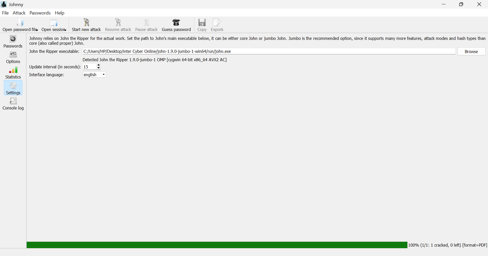
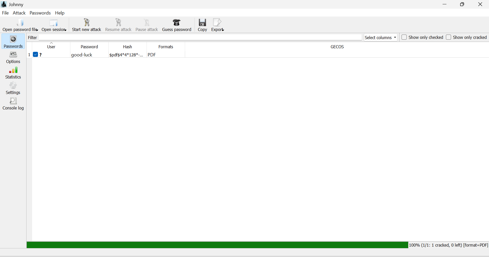
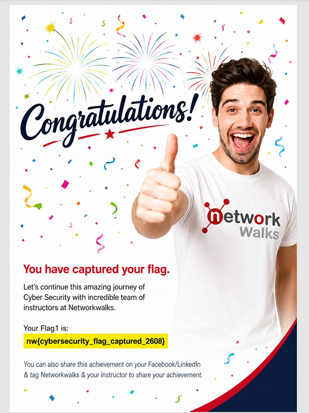
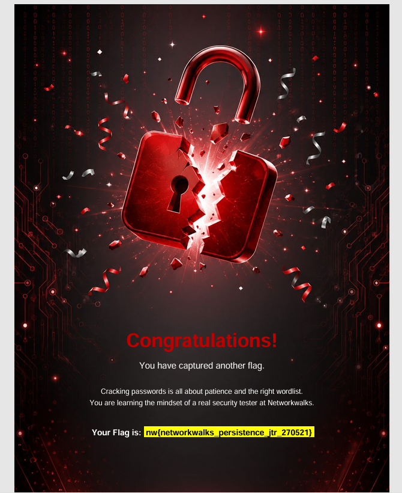
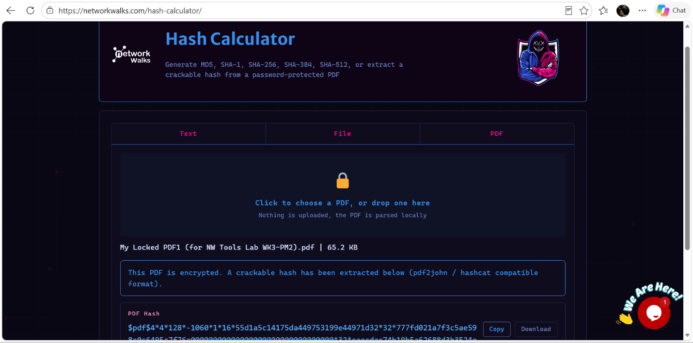
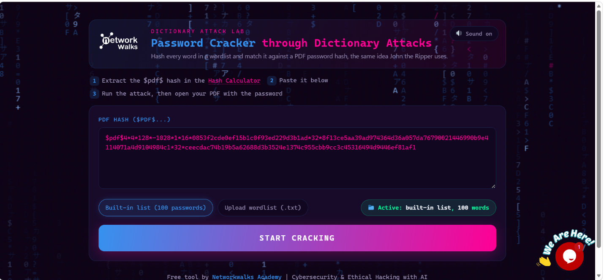
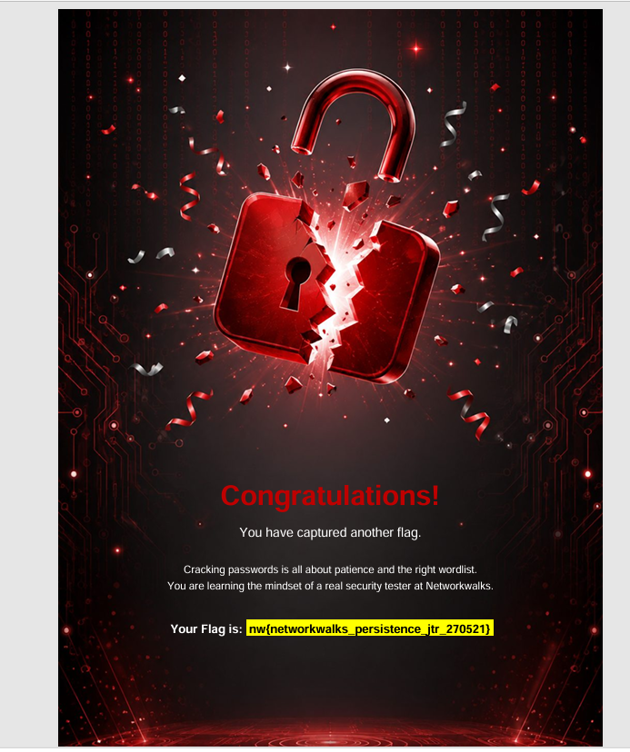

# 🔐 Cryptographic Hash Extraction & Dictionary-Based PDF Password Auditing


## 📋 Project Metadata

| Field | Details |
| :--- | :--- |
| **Prepared By** | **Kinza Abbasi** |
| **Report Date** | 19 November 2026 |
| **Report Type** | Week 3 Cybersecurity Practical Project Report |
| **Program / Batch** | Networkwalks Cybersecurity & Ethical Hacking – B084 |
| **Modules Covered** | `W3-PM1` & `W3-PM2` |
| **Primary Tools** | John the Ripper (`v1.9.0-jumbo-1 OMP`), Johnny GUI, Networkwalks Hash Calculator & Password Cracker |

---

## 🎯 Executive Summary

This repository contains the technical documentation, extracted `$pdf$` cryptographic hashes, verification screenshots, and formal Word report for the **Week 3 Cybersecurity Practical Project**. The assessment demonstrates end-to-end cryptographic auditing of password-protected PDF documents across two distinct operational methodologies:

1. **Project Module 1 (`W2-PM1`) — Offline Desktop Password Auditing:** Extracting `$pdf$` encryption hashes and performing dictionary-based password recovery using **John the Ripper (1.9.0-jumbo-1 OMP)** via the **Johnny GUI**.
2. **Project Module 2 (`W1-PM2`) — Client-Side Browser Hash Extraction & Cracking:** Parsing PDF encryption dictionaries locally in the browser using the **Networkwalks Hash Calculator** and executing wordlist audits via the **Networkwalks Dictionary Attack Password Cracker**.

---

## 📂 Repository Structure

```text
├── README.md                                              # Complete GitHub project documentation
├── report/
│   └── Week3_Cybersecurity_Lab_Report_Kinza_Abbasi.docx   # Formatted executive lab report
├── hashes/
│   ├── module_1_jtr/
│   │   ├── PDF_1_LAB_1_HASH.txt                           # Module 1 Target 1 ($pdf$4*4*128*)
│   │   ├── PDF_2_lab_1_HASH.txt                           # Module 1 Target 2 ($pdf$4*4*128*)
│   │   └── PDF_3_lab_1_HASH.txt                           # Module 1 Target 3 ($pdf$4*4*128*)
│   └── module_2_web_tools/
│       ├── pdf1.txt                                       # Module 2 Target 1 ($pdf$4*4*128*)
│       ├── pdf2.txt                                       # Module 2 Target 2 ($pdf$4*4*128*)
│       └── pdf3.txt                                       # Module 2 Target 3 ($pdf$4*4*128*)
└── screenshots/
    ├── 01_johnny_gui_jtr_configuration.png                # John the Ripper binary configuration in Johnny
    ├── 02_johnny_gui_password_cracked.png                 # Successful recovery of 'good-luck' (100% cracked)
    ├── 03_module1_pdf1_flag_captured.png                  # Decrypted Module 1 - PDF 1 flag proof
    ├── 04_module1_pdf2_flag_captured.png                  # Decrypted Module 1 - PDF 2 flag proof
    ├── 05_module1_pdf3_flag_captured.png                  # Decrypted Module 1 - PDF 3 flag proof
    ├── 06_networkwalks_hash_calculator_extraction.png     # Local browser $pdf$ hash extraction
    ├── 07_networkwalks_dictionary_password_cracker.png    # Web dictionary attack execution
    ├── 08_module2_pdf1_flag_captured.png                  # Decrypted Module 2 - PDF 1 flag proof
    ├── 09_module2_pdf2_flag_captured.png                  # Decrypted Module 2 - PDF 2 flag proof
    └── 10_module2_pdf3_flag_captured.png                  # Decrypted Module 2 - PDF 3 flag proof
```

---

## 📊 Consolidated Audit Results & Captured Flags

| Module | Target Document | Encryption Spec | Recovered Password | Captured Flag |
| :--- | :--- | :--- | :--- | :--- |
| **Module 1** | `PDF 1 (LAB 1 HASH)` | PDF V4 R4 (128-bit, `-1028`) | `good-luck` | `nw{cybersecurity_flag_captured_2608}` |
| **Module 1** | `PDF 2 (lab 1 HASH)` | PDF V4 R4 (128-bit, `-1028`) | *Audited via Wordlist* | `nw{networkwalks_persistence_jtr_270521}` |
| **Module 1** | `PDF 3 (lab 1 HASH)` | PDF V4 R4 (128-bit, `-1028`) | *Audited via Wordlist* | `nw{networkwalks_flag_260821_1}` |
| **Module 2** | `Locked PDF 1 (pdf1)` | PDF V4 R4 (128-bit, `-1060`) | *Audited via Web Tool* | `nw{networkwalks_flag1_jtr_270521_1}` |
| **Module 2** | `Locked PDF 2 (pdf2)` | PDF V4 R4 (128-bit, `-1028`) | *Audited via Web Tool* | `nw{networkwalks_persistence_jtr_270521}` |
| **Module 2** | `Locked PDF 3 (pdf3)` | PDF V4 R4 (128-bit, `-1028`) | *Audited via Web Tool* | `nw{networkwalks_flag_260821_1}` |

---

## 🛠️ Methodology & Execution Walkthrough

### 🔹 Project Module 1: Offline Auditing with John the Ripper & Johnny GUI

1. **Binary Integration:** Configured Johnny GUI to execute `john-1.9.0-jumbo-1-win64/run/john.exe` with 64-bit AVX2 OpenMP acceleration enabled.
2. **Hash Extraction & Loading:** Imported extracted `$pdf$` encryption hashes representing PDF Standard Security Handler Version 4, Revision 4 (`128-bit`).
3. **Dictionary Attack:** Executed wordlist auditing, cracking `PDF 1 (LAB 1 HASH)` (`good-luck`) and unlocking all three Module 1 files to verify their Capture-The-Flag tokens.

#### Extracted Module 1 Hashes

* **PDF 1 (`PDF_1_LAB_1_HASH.txt`):**

  ```text
  $pdf$4*4*128*-1028*1*16*ca7f72f11459cba469f1005a8765ed51*32*f32d8fa1bfbe2648226dffc39f7909ea0021446990b9e4114071a4d9104984c1*32*9322f50c29569712067a775264635e4954ccb1b99e209d664984054ffad30a6a
  ```

* **PDF 2 (`PDF_2_lab_1_HASH.txt`):**

  ```text
  $pdf$4*4*128*-1028*1*16*0853f2cde0ef15b1c0f93ed229d3b1ad*32*8f13ce5aa39ad974364d36a057da76790021446990b9e4114071a4d9104984c1*32*ceecdac74b19b5a62688d3b3524e1374c955cbb9cc3c45316494d9446ef81af1
  ```

* **PDF 3 (`PDF_3_lab_1_HASH.txt`):**

  ```text
  $pdf$4*4*128*-1028*1*16*34eb542eff4e1b0b32d25ce15a9a7281*32*b77872bfc9a24fb2f845066283a8fc1b0021446990b9e4114071a4d9104984c1*32*e7572256e4b552cd57988f5134214b91920d94d7a6bf550ea94a2995c7f2ab02
  ```

#### Visual Proof (Module 1)

| Johnny Configuration | Cracked Password (`good-luck`) |
| :---: | :---: |
|  |  |
| PDF 1 Flag | PDF 2 Flag | PDF 3 Flag |
| :---: | :---: | :---: |
|  |  |  |

---

### 🔹 Project Module 2: Browser-Based Extraction & Dictionary Auditing

1. **Client-Side Hash Parsing:** Used the **Networkwalks Hash Calculator** (`https://networkwalks.com/hash-calculator/`) to parse encrypted PDF headers locally without server-side file uploads.
2. **Dictionary Cracking:** Submitted the extracted `$pdf$` signatures to the **Networkwalks Password Cracker** using the built-in 100-password wordlist to recover user passwords and unlock all three targets.

#### Extracted Module 2 Hashes

* **PDF 1 (`pdf1.txt`):**

  ```text
  $pdf$4*4*128*-1060*1*16*55d1a5c14175da449753199e44971d32*32*777fd021a7f3c5ae598c0c6495c7f76e00000000000000000000000000000000*32*ceecdac74b19b5a62688d3b3524e1374c955cbb9cc3c45316494d9446ef81af1
  ```

* **PDF 2 (`pdf2.txt`):**

  ```text
  $pdf$4*4*128*-1028*1*16*0853f2cde0ef15b1c0f93ed229d3b1ad*32*8f13ce5aa39ad974364d36a057da76790021446990b9e4114071a4d9104984c1*32*ceecdac74b19b5a62688d3b3524e1374c955cbb9cc3c45316494d9446ef81af1
  ```

* **PDF 3 (`pdf3.txt`):**

  ```text
  $pdf$4*4*128*-1028*1*16*34eb542eff4e1b0b32d25ce15a9a7281*32*b77872bfc9a24fb2f845066283a8fc1b0021446990b9e4114071a4d9104984c1*32*e7572256e4b552cd57988f5134214b91920d94d7a6bf550ea94a2995c7f2ab02
  ```

#### Visual Proof (Module 2)

| Local Hash Calculator | Dictionary Attack Cracker |
| :---: | :---: |
|  |  |
| Locked PDF 1 Flag | Locked PDF 2 Flag | Locked PDF 3 Flag |
| :---: | :---: | :---: |
|  |  |  |

---

## 🔍 Cryptographic Analysis & Security Recommendations

* **Hash Anatomy (`$pdf$4*4*128*`):** Indicates PDF Standard Security Handler **V=4, R=4** utilizing a **128-bit** key length, a 16-byte document ID salt, and 32-byte owner (`/O`) and user (`/U`) verification hashes.
* **Permission Bitmasks:** Targets in Module 1 and `pdf2`/`pdf3` use permission flag `-1028`, whereas `pdf1` uses `-1060` with an independent salt and `/O` hash.
* **Remediation & Hardening:**
  1. **High-Entropy Passphrases:** Replace dictionary-vulnerable passwords (such as `good-luck`) with randomly generated 14–16+ character passphrases.
  2. **Upgrade to AES-256 (PDF 2.0 / V=5, R=6):** Legacy Revision 4 handlers allow rapid offline dictionary iteration; modern SHA-256/384/512 key stretching significantly increases brute-force resistance.
  3. **Certificate-Based Encryption / DRM:** Pair sensitive corporate documents with X.509 digital certificates or Information Rights Management (IRM).

---

## ⚠️ Ethical Disclaimer

*All activities, cryptographic extractions, and password recovery procedures documented in this repository were conducted strictly within an authorized educational lab environment as part of the **Networkwalks Cybersecurity & Ethical Hacking (Batch B084)** curriculum.*
